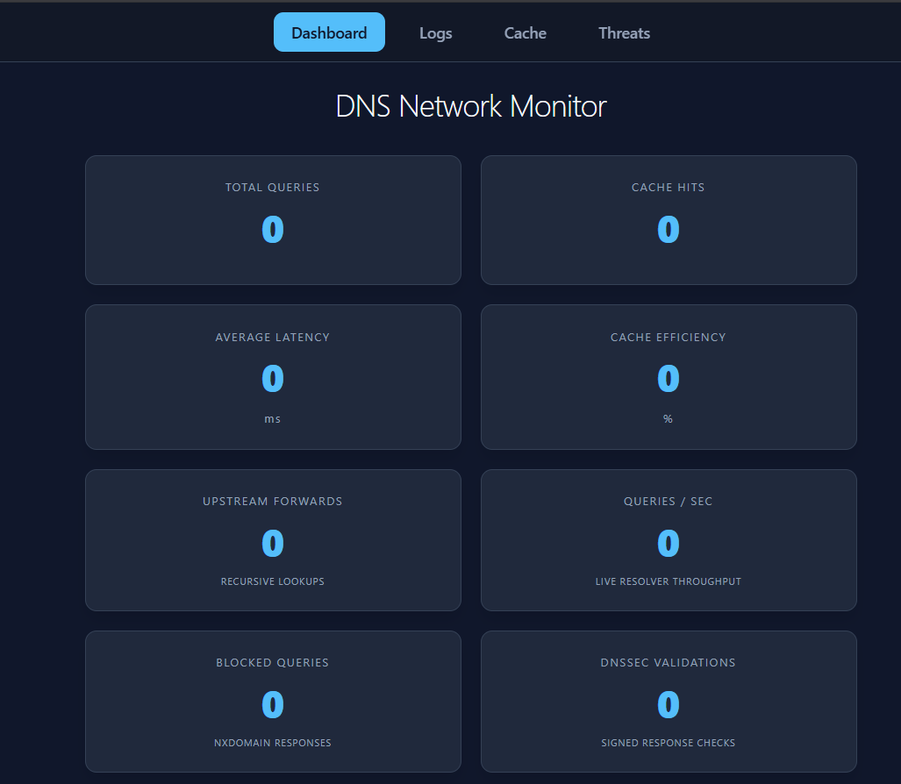
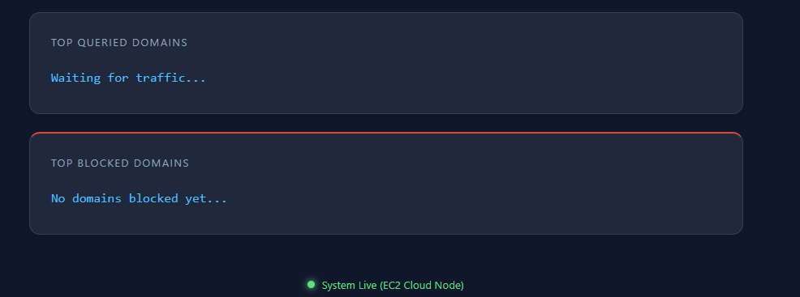
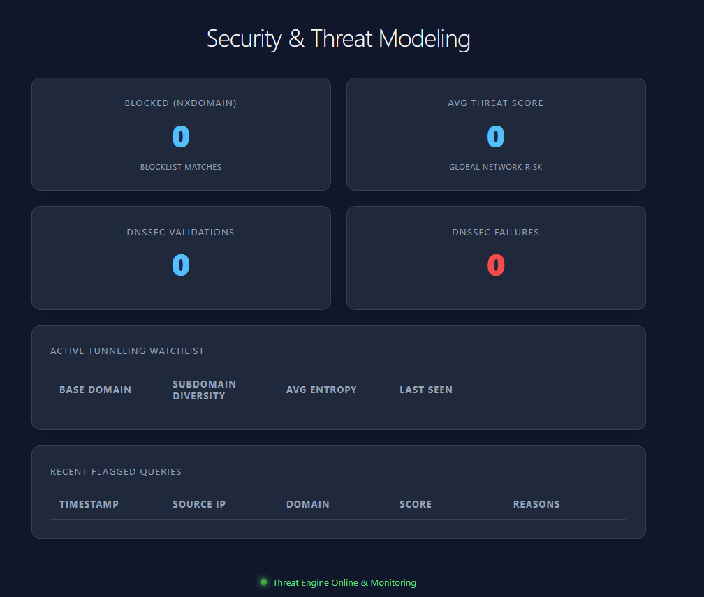
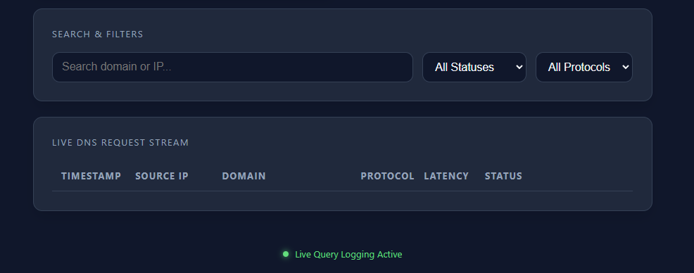

# Rust DNS Resolver & Security Monitor

A DNS resolver, built from scratch in Rust, that doesn't just answer "what's the IP for this domain?" — it watches its own traffic for signs of attack. It parses raw DNS packets off the wire, cryptographically signs its answers, blocks known-bad domains, and runs every query through a threat-detection engine designed to catch **DNS tunneling** — a technique attackers use to sneak data in and out of a network hidden inside ordinary-looking DNS lookups. A live web dashboard shows all of it happening in real time.

This was built as a semester project for a networking course (CSI-4321/5321), and is deployed live on AWS EC2.

<p align="center">
  
  
</p>

---

## What problem does this solve?

Every time a device visits a website, it first asks a DNS resolver "what server does this name point to?" That lookup is normally invisible and boring — which is exactly why attackers abuse it. Because DNS traffic is almost never blocked by firewalls, malware uses it as a covert channel to exfiltrate stolen data or receive commands from an attacker, one sneaky-looking subdomain at a time. This is called **DNS tunneling**.

This project implements a resolver that inspects every single query as it passes through, scores it for suspicious behavior, and surfaces the evidence on a live dashboard — while still doing the resolver's actual job of answering queries quickly and correctly.

## Security features (the core of the project)

- **DNS tunneling detection** — every query is scored using [Shannon entropy](https://en.wikipedia.org/wiki/Entropy_(information_theory)) of its subdomain labels (random-looking, high-entropy strings are a hallmark of encoded/exfiltrated data), label length, per-IP query frequency, and subdomain diversity per parent domain. Queries that cross a threshold are flagged, logged, and added to a **tunneling watchlist** with the actual evidence (sample queries, entropy scores, timestamps).
- **DNSSEC (signed responses)** — every response the resolver returns is cryptographically signed with an ECDSA P-256 key pair (via `RRSIG`/`DNSKEY` records), so a client can verify the answer really came from this resolver and wasn't tampered with or spoofed in transit.
- **Domain blocking (ad/malware blocklist)** — a Pi-hole-style blocklist checks every query against a list of known ad/tracker/malicious domains and returns `NXDOMAIN` for anything on it, before the query ever leaves the network.
- **DNS over HTTPS (DoH)** — implements [RFC 8484](https://www.rfc-editor.org/rfc/rfc8484), so DNS queries can be sent encrypted inside HTTPS instead of as plaintext UDP, closing off a common eavesdropping/interception vector.
- **Live security telemetry** — a real-time web dashboard shows query volume, cache performance, blocked-domain counts, DNSSEC success/failure rates, average threat score, a security event timeline, and the full tunneling watchlist with evidence.
- **Attack simulation kit** — includes Python scripts (`utils/scripts/`) that generate realistic DNS tunneling traffic (mimicking tools like `iodine`/`dnscat2`) alongside benign traffic, so the detector's behavior can be demonstrated and validated against a real attack pattern rather than a hypothetical one.

<p align="center">
  
</p>

## How a query flows through the system

1. A DNS query arrives over raw UDP (port 53) or as an encrypted DoH `POST` request.
2. The raw bytes are parsed into a structured DNS packet.
3. The threat engine scores the query for tunneling indicators (entropy, frequency, label length, subdomain diversity) and logs anything suspicious.
4. The domain is checked against the blocklist; blocked domains get an immediate `NXDOMAIN`.
5. If the answer is already cached (and not expired via TTL), it's returned immediately.
6. Otherwise, the query is forwarded upstream (to `8.8.8.8`), the response is cached, and stats/latency are recorded.
7. The final response is signed with the resolver's DNSSEC key before being sent back to the client.
8. Every step updates shared, thread-safe statistics that the web dashboard polls live via a JSON API.

<p align="center">
  
</p>

## Tech stack

| Layer | Technology |
|---|---|
| Resolver core | Rust, [Tokio](https://tokio.rs/) (async UDP networking, concurrency) |
| Web server / API | [Axum](https://github.com/tokio-rs/axum) |
| Cryptography | [`ring`](https://github.com/briansmith/ring) (ECDSA P-256 for DNSSEC signing) |
| Frontend dashboard | Static HTML/CSS/JS polling a JSON API |
| Deployment | AWS EC2, Caddy (TLS termination for DoH), GitHub Actions CI/CD |
| Attack simulation | Python |

## Project structure

```
server/     the resolver itself — packet parsing, caching, DNSSEC, threat detection,
            blocklist, DoH endpoint, and the web/API server (Axum)
client/     a minimal DNS test client for querying either the system resolver or
            this custom resolver directly, with DNSSEC validation
utils/      Python scripts that simulate normal traffic and DNS-tunneling attack
            traffic, used to demonstrate/validate the threat detector
static/     the live monitoring dashboard (Dashboard, Logs, Cache, Threats pages)
```

## Running it locally

```bash
# Build and run the resolver + web dashboard
cargo run -p server

# The web dashboard is served at http://localhost:8080
# The DNS resolver listens for UDP queries on port 53

# Query it with the included test client
cargo run -p client
# then type: c example.com   (uses the custom resolver, with DNSSEC validation)
#        or: d example.com   (uses your system's default resolver)
```

To see the threat detector in action, point the demo scripts in `utils/scripts/` at your running resolver — see `utils/scripts/Readme.md` for details on simulating both benign and DNS-tunneling traffic.

---

## Course submission

*The sections below are retained from the graded project submission for CSI-4321/5321.*

### What is your project?
Our project is a DNS resolver written in Rust that supports traditional UDP DNS queries and DoH (DNS over HTTPS).
Our resolver included a packet parser, caching with TTL expiration, DNSSEC validation/signing, pi-hole domain blocking
(ad blocker engine), threat detection for suspicious DNS activity and identifying DNS tunneling, and a live statistics
monitoring dashboard.

### What novel work did you do?

- **Sofia** — For the statistics and monitoring infrastructure/dashboard, we worked on the internal API
  endpoints, in-memory logging system, live query stream, cache monitoring page, DNSSEC statistics, and threat
  visualization pages. Most of the work for the website required connecting the separate backend systems together
  and integrating them into the resolver pipeline or exposing them to the frontend. We connected the DNS resolver,
  stats engine, and frontend dashboard pages to track and display live info about blocked domains, threat scores,
  cache hits, tunneling alerts, and DNSSEC activity.

- **Josh** — I implemented DNSSEC for the connection between our client and the DNS resolver. It is not a true implementation of DNSSEC as we are limited with resources, but I implemented a general format for how it works. The client sends a request to the server to receive the DNSKEY that can be used to verify responses sent from the server. The server builds the DNSKEY response and then sends it. The client caches it so that it can ensure verified communication with the server. When the client asks for the IP address of a website, the server will sign the response using an RRSIG that is created using the server's private key. The client uses the DNSKEY response cached from earlier in order to verify that the server did indeed send the message and not a bad actor. The response will contain a RRSIG that can be verified using the DNSKEY.

- **Chase** — I implemented a DNS server featuring a core UDP listener on port 53 that handles query parsing, upstream forwarding to 8.8.8.8, and in-memory TTL caching. To secure the traffic, I developed a phase-one threat detection engine that calculates Shannon entropy for subdomain labels and monitors for anomalies like excessive label lengths, high query frequency per IP, and subdomain diversity. This system specifically targets DNS tunneling by tracking per-domain patterns over time, flagging bursts of high-entropy queries and maintaining a detailed watchlist of suspicious domains with associated evidence and threat scores.

- **Noah** — Worked with CI/CD and AWS, setting up architecture on EC2, pi-hole domain blocking, and DNS over HTTPS. A lot of the work was setting up architecture and things to enable other features on the project. One of the most confusing things was figuring out how to deal with HTTPS encapsulation of DNS requests, which I ended up unpacking by letting Caddy receive the HTTPS and send the decrypted HTTP requests to the program.

### What did you learn?
The initial foundation of our project focused on learning about DNS at the packet level, such as DNS headers, name compression, caching, response codes, and DNSSEC records. We also further learned about atomics, mutexes, Tokio async networking, and thread safe shared states in Rust programming. We learned how to connect our Rust backend to a live monitoring dashboard that continuously updated the DNS statistics by using JSON APIs and JavaScript fetch requests.

We also learned about encapsulation and how useful it is to unpack certain things to utilize different tools available to unpack things on different layers of the OSI model. We also learned how to secure our code production, making sure that code is not stored on the server itself and only necessary ports are exposed.

- Security features (what makes DNS tunneling)
- DNSSEC (public key encryption)

### What was challenging?
When compiling the statistics for our website, my biggest challenge was integration/connection because many systems worked independently. For example, the logic for some security and threat-detection components existed but were not connected to the resolver loop, stats engine, or frontend APIs, so events were not able to appear on the dashboard until further connective code was implemented. Likewise, for each use case this often involved having to change logic across 2-4 different files to make sure it was still working correctly and was being tracked accurately.

Another challenge was concurrency and synchronization. Because the resolver handled the network traffic asynchronously, it was important to pick whether data (logs, cache, statistics) would be recorded as atomics or mutexes to avoid race conditions and deadlocks.

A lot of the early challenges we faced had to do with project architecture as well. Setting up CI/CD, AWS EC2, AWS IAM, and setting up a service on Ubuntu all proved to be confusing, with small errors taking a lengthy amount of time to fix.

Understanding how to implement DNSSEC in a new way was difficult because we implemented a DNS resolver and client. Normally, authoritative servers are the ones who contain a DNSKEY and they sign responses that are sent to the DNS resolver. We had to implement DNSSEC between the resolver and client. Learning how a DNSKEY response is structured and how RRSIG signs responses was challenging.

### What AI tools did you use, and what did you use them for? What were their benefits and drawbacks?
We used Google Gemini AI to ask questions relating to an issue we had when trying to host our website locally on port 8080 while also running the resolver with real traffic using Cargo inside the remote Docker development container in Rust Rover (in early development we wanted to avoid changing our AWS main website). It helped us try potential solutions and conclude that the website was only accessible inside the terminal/container environment and not from a local browser, and thus we needed a different method if we wanted to host the website locally. Benefits were that it provided a more knowledgeable view of the schematics than we personally had, and it was able to provide us with feedback and potential solutions in real time. A drawback was that we had to push it towards that final conclusion based on personal instinct, as initially it was continuously providing solutions that were simply not possible, and in the end, we did end up consulting two members for confirmation and not just trusting the AI's word.

We also used AI to outline the project and split it up into conceptual parts that we could all work on and then have deliverables we worked on each week without having to depend on sequential work from the others. This was honestly a useful tool in splitting up work and project management, especially in establishing scope for how hard and lengthy some parts of the project would be. We also used AI to help write out JSON files for IAM in AWS, which felt like shooting myself in the foot repeatedly. Claude could not fix visibility issues and overcomplicated a simple issue into something much bigger. The fix ended up just setting up the same AWS region rather than messing with finicky IAM permissions. We also used Claude to generate normal traffic and attacker DNS tunneling traffic simulation Python scripts that we could test against our DNS server. The scripts were very useful but very ill documented, causing some errors that delayed testing.

We also used Claude to help with cryptography and packaging DNSKEY/RRSIG. The binary serialization of the public key was done by Claude and turned into wire format due to ECDSA P-256 requirements, and it was very helpful. It also helped with the checksum for the key tag, allowing us to ensure that the client was able to correctly identify which public key was used. Since the idea was so complex, Claude was very useful in helping us understand how to package responses.

### What would you do differently next time?
There were certain logic choices made within our project that sufficed for the scope of our class knowledge and project scope, but if we expanded our project, it may introduce slower output, bottlenecks, or high memory usage. For example, if we introduced over a million queries to our current UDP listener, the current global lock implementation would cause a bottleneck, so if we did the project again, we could explore further into how to handle threads for large-scale production.

Additionally, we would've liked to have expanded the DNS client package to provide more information than `dig` or `nslookup` CLI tools. We decided not to implement this any further because the monitoring website accomplished the same thing within a GUI.
